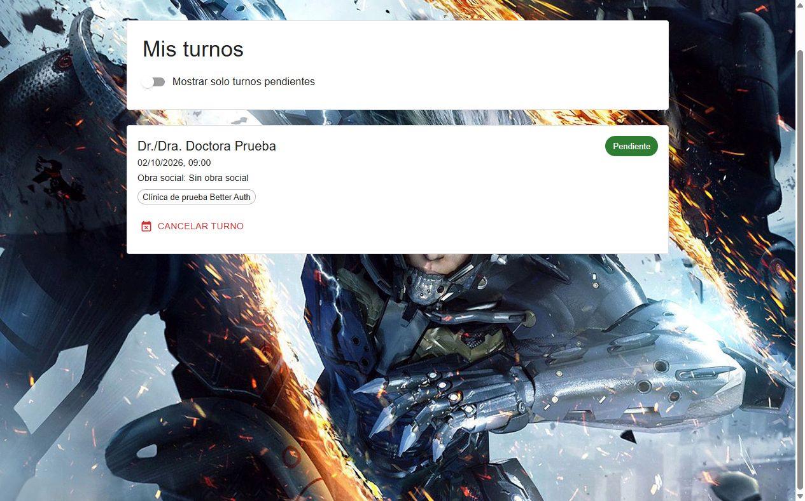
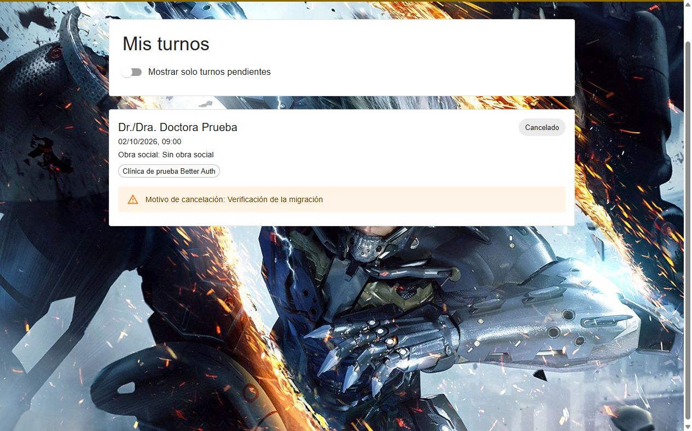

# Verificación de Better Auth

Rama: `codex/better-auth`. Fecha: 1 de octubre de 2026. Entorno local: MySQL `tp`, Express 3000 y Vite 5173. Navegador: `http://localhost:5173`, API mediante proxy `/api`.

## Comprobaciones automáticas

- Backend `pnpm build`: correcto, sin errores TypeScript.
- Backend `pnpm test`: 5 archivos, 34 tests correctos.
- Frontend `pnpm build`: correcto. Advertencia de tamaño del bundle, sin error de compilación.
- Frontend `pnpm test`: 1 archivo, 3 tests correctos.
- Frontend `pnpm test:e2e`: 2 tests correctos, ingreso y restauración de perfil al recargar; validación del email.

Se adaptaron los tests existentes y se añadieron solo dos casos de integración. Estos verifican sincronización del perfil y cambios de rol con una sesión ya abierta, rechazo de origen ajeno, DNI inmutable, protección de cuentas con relaciones sin perder sus credenciales, duración de 86.400 segundos, vencimiento sin renovación y cierre que invalida la cookie. Los tests anteriores siguen verificando reservas, propiedad de agendas, permisos del doctor y estados de turno.

## Recorrido real, sin mocks

1. Ingreso con admin de prueba. Acceso a altas administrativas.
2. Alta de especialidad `Clínica de prueba Better Auth`, doctor matrícula 700001 y asignación de especialidad.
3. Cierre del admin; ingreso con doctor. Se muestran Mi agenda y Turnos con pacientes, y se crea agenda para viernes de 09:00 a 12:00.
4. Cierre del doctor; registro público del paciente. La aplicación confirma cuenta creada y pide iniciar sesión.
5. Ingreso del paciente; navegación a especialidad y selección del 02/10/2026 a las 09:00.
6. Reserva con Doctora Prueba, sin obra social. Aparece en Mis turnos como Pendiente.
7. Recarga completa: mantiene la sesión y muestra el turno.
8. Cancelación con motivo `Verificación de la migración`: aparece Cancelado.
9. Consola del navegador: sin errores durante el recorrido.

Las cuentas y el turno de demostración permanecen en la base local. Los usuarios de las suites automáticas se limpian al terminar.

## Cuentas locales de demostración

Solo para esta base de desarrollo descartable:

| Rol | Email | Contraseña |
| --- | --- | --- |
| Admin | admin.migracion@example.com | Admin2026! |
| Doctor | doctor.migracion@example.com | Doctor2026! |
| Paciente | paciente.migracion@example.com | Paciente2026! |

Estas contraseñas son datos de prueba; no reutilizarlas al desplegar.

## Capturas

## Límites de la comprobación

Resend conserva su implementación; no se verificó la entrega externa de correos. La recuperación de contraseña queda pendiente según el alcance acordado. No se comprobó un despliegue de producción.

Los lockfiles de pnpm y npm incluyen Better Auth 1.7.7. El lockfile de npm del frontend se regeneró en una carpeta temporal con `--legacy-peer-deps` por un fallo de npm 10 al resolver peers; el proyecto se instaló y verificó con pnpm. El lint adicional no pudo ejecutarse porque el binario de ESLint no estaba disponible en la instalación local.
