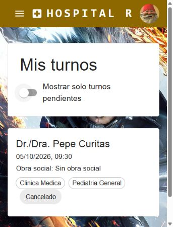

# Verificación local — 1 de octubre de 2026

Aplicación ejecutada con frontend en http://127.0.0.1:5173 y backend en http://localhost:3000, conectado a MySQL real.

## Recorrido realizado en navegador

1. Registrar el paciente ficticio Prueba Recorrido: cuenta creada.
2. Iniciar sesión: aparece el nombre del paciente.
3. Abrir Reserva Online y Clínica Médica: se muestran las especialidades y los días disponibles.
4. Elegir el 5 de octubre de 2026 a las 09:30, doctor Pepe Curitas y Sin obra social.
5. Confirmar: el turno aparece como Pendiente en Mis turnos.
6. Cancelar sin indicar un motivo: el turno aparece como Cancelado.
7. Recargar: la cancelación persiste.
8. Activar el filtro de pendientes: aparece «No tenés turnos pendientes».
9. Volver a consultar el calendario: el horario 09:30 vuelve a estar disponible.
10. Abrir el diálogo del doctor: sin nuevos errores ni advertencias de consola tras corregir el HTML.
11. Cerrar sesión y abrir Mis turnos: se solicita crear una cuenta o iniciar sesión.
12. Iniciar sesión nuevamente: el historial conserva el turno cancelado.

La cuenta ficticia y su turno cancelado se conservaron como evidencia; no queda una reserva pendiente del recorrido. Los datos de las pruebas de integración fueron limpiados, incluidos los restos de una ejecución que falló durante la limpieza.

## Comprobaciones automatizadas

- Backend: compilación TypeScript aprobada y 32 pruebas aprobadas, 0 fallidas.
- Frontend: compilación TypeScript y build Vite aprobados; 3 pruebas aprobadas, 0 fallidas.
- Nueva prueba de integración: disponibilidad mensual por doctor y especialidad sin autenticación.
- `git diff --check` sobre los archivos modificados en esta verificación: aprobado. El chequeo global detecta espacios finales en un cambio previo de `usuario.controlador.ts`.

Informes completos: [backend-tests.json](backend-tests.json) y [frontend-tests.json](frontend-tests.json).

## Correcciones realizadas

- Rutas de turnos: retirar la referencia al middleware inexistente y reconectar la disponibilidad mensual y las rutas de atención del doctor a sus controladores existentes.
- Tipos del frontend: corregir los nombres del doctor, los estados del turno y las interfaces faltantes para que coincidan con el backend.
- Selector del doctor: usar un contenedor `div` para evitar elementos `div` dentro de un párrafo.
- Tests de integración: usar un EntityManager separado, evitar la carrera por redondeo de segundos de MySQL y limpiar las notificaciones antes de borrar los turnos de prueba.

## Alcance

Se verificó el flujo del paciente en navegador y los escenarios de doctor/agenda/asistencia mediante las pruebas de integración existentes. No se verificó la entrega de correos externos ni se recorrieron todas las pantallas administrativas. Vite emitió una advertencia de tamaño del bundle (725 kB), sin impedir el build.

